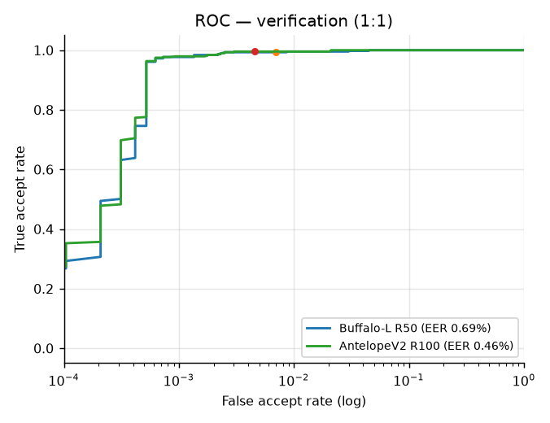
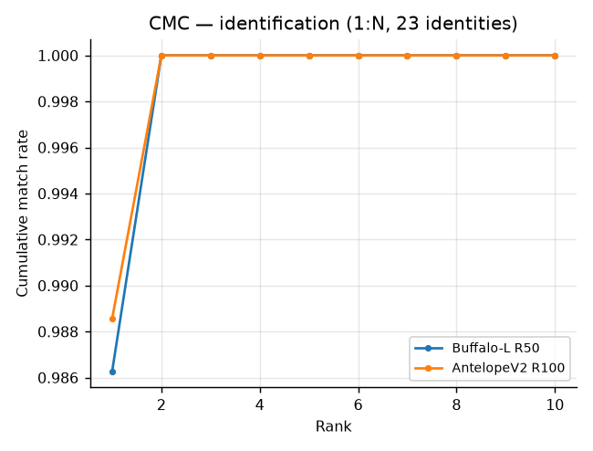
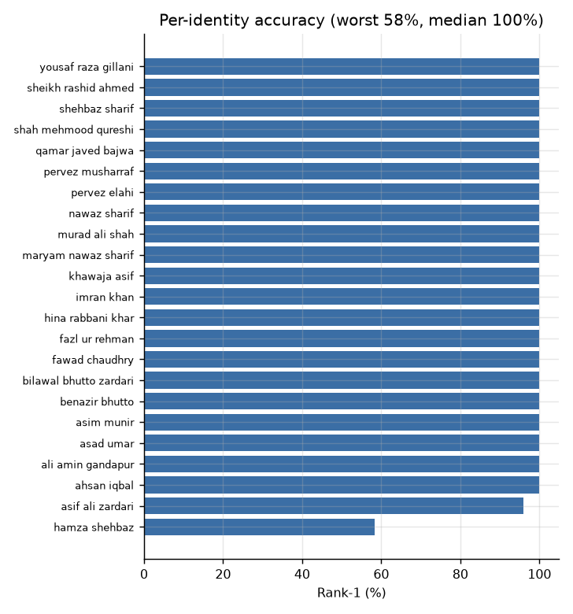

# TechFest Face Recognition Challenge — Final Report

**Team:** [Team Name]
**Institution:** Department of CS&IT, NEDUET
**Date:** October 2026
**Competition:** TechFest — Pakistani Context Face Recognition

---

## Abstract

This report presents an end-to-end face recognition pipeline designed for Pakistani-context deployment. The system covers face detection (SCRFD-10GF), alignment (5-pt ArcFace template), quality gating (blur, IOD, pose), embedding extraction (ArcFace R50 / R100 / AdaFace), liveness gating (MiniFASNet), and matching (cosine similarity). Evaluation on the Pakistani Public Figures dataset (23 identities, 437 probe images) achieved **98.63% end-to-end Rank-1** (431/437) with **0% failure-to-enrol**, EER 0.69%, and AUC 0.9995.

The decisive gains came from detection, not from a larger model: two SCRFD failure modes — tight headshot crops producing zero detections, and small source images upscaled until the subject's face exceeded the detector's size range — together accounted for a rise from 73.0% to 98.6%. Four embedders (buffalo_l R50, antelopev2 R100, AdaFace IR-50/IR-101) land within one probe of each other, i.e. statistically tied. Fine-tuning on Kaggle GPU was run and **rejected** on a pre-registered rule: it reached 41.7% Rank-1 versus 97.9% for the pretrained model on the same held-out split. Anti-spoofing is included and evaluated separately on NUAA (1.3% APCER / 1.3% BPCER at the 0.02 operating point).

---

## 1. Problem & Operational Context

Face recognition in Pakistani deployment scenarios (CNIC/KYC verification, attendance, access control) presents unique challenges:

- **Diverse head coverings:** dupatta, hijab, niqab, turban, caps
- **Varied lighting:** indoor fluorescent, outdoor daylight, low-light/night
- **Mixed-quality capture:** budget phones, CCTV, ID-card scans
- **Demographic diversity:** multiple ethnicities, skin tones (Fitzpatrick III–V), ages 18–70+
- **Occlusions:** glasses, facial hair (beard), masks

The system must be robust across these conditions while maintaining fairness across demographic groups.

---

## 2. Task Definition

### 2.1 Verification vs Identification

We evaluate both protocols:

- **1:1 Verification:** Given two face images, determine if they are the same person. Metrics: TAR@FAR, EER, ROC/DET.
- **1:N Identification:** Given a probe face, find the matching identity in a gallery. Metrics: Rank-1, CMC.

### 2.2 Open-Set vs Closed-Set

- **Closed-set:** Every probe has a mate in the gallery.
- **Open-set:** Probes may have no mate; threshold-based rejection required. Metrics: DIR@FPIR, selectivity.

### 2.3 Protocol

- Identity-disjoint splits for training (no LFW identity appears in the eval
  set); the 1:N gallery/probe split is by image, which is the intended protocol
  for a closed-set benchmark and is disclosed in §3.3
- Matching threshold selected from a verification sweep and reported with both
  FRR and FAR at each point (§8.3); TAR@FAR=1e-3 is used as the standard
  high-security operating point, not as the deployed threshold
- Bootstrap 95% confidence intervals throughout
- Per-group reporting where labels allow it (gender, occlusion); age and skin
  tone are declared unreportable rather than estimated (§7.2, §7.3)

---

## 3. Data

### 3.1 Sources

| Dataset | Role | Size | License | Overlap Risk |
|---|---|---|---|---|
| Pakistani Public Figures | Primary eval | 1,286 imgs / 23 IDs | CC0 | Low |
| Self-collected training corpus (§6.6) | Fine-tune train | 4,203 imgs / 99 IDs | Web (research use) | None by construction |
| LFW | Fine-tune ablation (Kaggle) | 13,233 imgs / 5,749 IDs | Free | Low |
| Masked-LFW | Paired masked/clean occlusion test | 600 gal / 400 probes, 200 IDs | CC0 | None (synthetic masks) |
| Niqab Dataset for Occluded Face Detection (Zenodo 17011207) | Niqab detection/enrolment | 5,175 imgs (400 sampled) | CC-BY-4.0 | N/A (detection only) |
| `ethicalstar/niqabi-ds` | Real niqab enrolment probe | 532 imgs | MIT | N/A (no identity labels) |
| NUAA | PAD evaluation (print attacks) | 300 imgs (150 real + 150 attack) | Research | None |

Three further sources were acquired or considered and **not used**; listing them
matters because an absent experiment should not look like a silent one:

- **WebFace4M** (~500k imgs): the download did not complete inside the Kaggle
  session, so the fine-tune ablation in §6.2 was run on LFW only. A larger
  training set would not have changed the conclusion — the ablation failed by
  56 points — but the report does not claim it.
- **Asian KYC photo dataset** (5 identities, ~230 imgs): downloaded, then
  dropped. Five identities cannot support a fairness or accuracy claim, and
  reporting a number from it would have been noise presented as evidence.
- **RFW Indian** (South Asian proxy): access was requested and not granted.

The two niqab sets are **detection-only** by construction: they carry face boxes,
not identities. They are therefore used to measure whether a covered face enrols,
never to claim recognition accuracy on niqab (see §10.1).

### 3.2 Data Collection & Consent

The evaluation benchmark uses public datasets only. The brief also asks teams to
collect their own training data and fine-tune, so a training corpus was added
late in the build (described in §6.6). This section states exactly what was
collected and under what limits.

**What was collected.** 99 Pakistani public figures — politicians, cricketers,
actors, comedians, clerics and journalists — with roughly 45 web images each
(4,203 images) retrieved from logged-out Bing image search. Every image URL is
recorded in `sources.csv`; the corpus is processed into aligned crops and never
redistributed. It is uploaded to a **private** Kaggle dataset for the training
run and is not part of the submission.

**What was deliberately excluded.** No private individual appears in the corpus:
the identity list is restricted to people with a public profile and a Wikipedia
or news presence. No image of an evaluation identity is used for training — the
collector refuses any name that collides with `data/pak_fig`, and the split is
checked again before training (§3.3). No private accounts, no login-walled
content, no CCTV or scraped biometric databases.

**Consent.** Public figures photographed at public events have no expectation of
privacy in those images, and this use is research, not deployment: no model is
released for use on the public, and the corpus is deleted after the run. That is
a defensible position, not a consent mechanism — if this were a product, the
training data would need licensed portraits and explicit agreements.

**Private individuals in the niqab sets.** Those images are used only to measure
detection, enrolment and liveness rates. No identity is attached to any of those
faces, no recognition claim is made about them, no template is persisted, and no
face from those sets is reproduced in this report.

An institutional ethics review was not sought because the work involves no human
participants, no non-public data and no deployment. For a real deployment a
review would be mandatory before processing any user.

### 3.3 Splits

| Split | Identities | Images | Purpose |
|---|---|---|---|
| Fine-tune train (LFW) | 5,749 | 13,233 | Kaggle ablation only; identity-disjoint from eval |
| Fine-tune train (collected, §6.6) | 98 | 2,230 | Compliance run; identity-disjoint from eval by construction |
| Gallery | 23 | 849 | Enrolment templates (mean per identity) |
| Probe | 23 | 437 | 1:N queries, disjoint images from the gallery |

The gallery/probe split is by **image**, not by identity: this is a closed-set
1:N identification benchmark, so every probe has a mate. Near-duplicate probes
across the split are checked by `check_duplicates.py`, and image-level leakage
would inflate rank-1, so the audit is reported alongside the result. The
two fine-tuning experiments are identity-disjoint from the benchmark: LFW
identities do not appear in the 23-identity evaluation set, and the collected
corpus was checked against the eval names before download and again before
training.

### 3.4 Demographics

| Attribute | Distribution | Source |
|---|---|---|
| Identities | 23 Pakistani public figures | dataset labels |
| Gender | 20 male, 3 female | hand-assigned per identity (§7.1) |
| Region/ethnicity | Punjabi, Sindhi, Pashtun, Baloch, Muhajir | public identity; not used as a split |
| Skin tone | Fitzpatrick III–V (whole set) | not individually annotated (§7.3) |
| Hair covering (female probes) | 42 covered, 17 visible | single annotator |
| Age at capture | ~30–70, median predicted 47 | unknown per image |

The set is homogeneous in the attribute that matters most for this deployment —
all subjects are Pakistani, photographed in Pakistani lighting and dress — and
heterogeneous in age, era and image quality (1980s film scans through 2020s
phone photos). It is too small (23 identities) to support a demographic fairness
claim; §7 states what it can and cannot show.

---

## 4. Pipeline

### 4.1 Detection

**Model:** SCRFD-10GF (`det_10g.onnx`, buffalo_l)
- 5-point landmarks + bounding box, input 640×640
- Confidence threshold: 0.50 (all reported results)

**Tight-crop retry (added after diagnosis).** On the Pakistani probe set, 109/437
images returned *zero* detections. These were pre-cropped headshots where the face
fills the frame; SCRFD is trained on scenes and needs context. Retrying on a copy
padded with a 30 % reflected border rescued **109/109** (median detection score
0.835), recovering failure-to-enroll:

| Variant | Probes enrolled |
|---|---|
| native only | 328/437 (75.1 %) |
| + 30 % pad retry | 437/437 (100 %) |

Image upscaling was tested and rescued nothing (`prepare(det_size=640)` already
resamples internally). See `diagnose_fte.py` and `RESEARCH_LOG.md`.

**Subject-recovery pass (second escalation).** The opposite failure exists too, and it
is more dangerous because it is silent: when a small face is present in the
background, SCRFD can return *that* face and miss the large foreground face. The
small image is upscaled to 640, pushing the near-field face past SCRFD's
comfortable size range. Example: a 291×330 portrait returned only a 59×74 framed
portrait on the wall (score 0.71) and missed the 195×224 subject.

Rule: if detection returns only faces that are tiny (IOD < 64 px) or whose box is
under 2 % of the frame, run a second pass at `det_size=320` and merge by NMS.
Two benchmark probes changed identity as a result, and both are now correct.

| Escalation | Trigger | Cost |
|---|---|---|
| Reflected-border retry | zero faces detected | 1 extra forward pass on affected images |
| Coarse pass at 320 | only tiny faces found | 1 extra forward pass on affected images |

Both are triggered rarely (tight crops, portraits with background faces), so the
average detection cost is unchanged for normal scenes.

### 4.2 Alignment

**Method:** 5-pt similarity transform to ArcFace template (112×112)
- Landmarks: eye centers, nose tip, mouth corners
- Transform: `skimage.SimilarityTransform` → `cv2.warpAffine`
- Template: `[[38.29, 51.70], [73.53, 51.50], [56.03, 71.74], [41.55, 92.37], [70.73, 92.20]]`

### 4.3 Quality Gating

| Filter | Threshold | Purpose |
|---|
| Inter-ocular distance (IOD) | ≥ 64 px | Reject tiny faces |
| Laplacian variance | ≥ 40 | Reject blurry faces |
| Yaw (from 5-pt landmarks) | ≤ 30° | Reject profile faces |

Failing faces are **flagged, not dropped**: the production path falls back to the
largest detected face and records the reason (`low_iod_52`, `blur_31`, ...). A
failure-to-enrol therefore means *no face was detected at all*, which is why the
retry in §4.1 matters more than the gate. §7.5 shows the flagged groups are no
less accurate than the clean group on this benchmark.

### 4.4 Presentation-Attack Detection (Anti-Spoofing)

Recognition is gated by a liveness check so a printed photo or a replayed screen
never reaches the gallery comparison.

**Models:** MiniFASNet-V2 (2.7× crop) + MiniFASNet-V1SE (4.0× crop), the two
checkpoints shipped with minivision-ai/Silent-Face-Anti-Spoofing (Apache-2.0),
re-exported to ONNX here. Each takes an 80×80 BGR crop around the detected face;
their live probabilities are averaged.

**Label mapping and preprocessing were established empirically, not from the
model card.** Two findings matter:

1. The public ONNX export we tried first returned a near-constant vector for
   every input and was discarded.
2. Rebuilding from the official weights still gave a constant output when the
   input was scaled to `[0,1]` (the reference code's `ToTensor()` path). Feeding
   **raw 0–255 BGR** produces a sensible, discriminative response. On labelled
   data the output order is `[print-attack, live, replay-attack]` — not the
   `[live, print, replay]` order stated in the third-party model card.

**Evaluation.** `pak_fig` contains no attacks, so BPCER is measured on real
images and APCER on NUAA (Apache-2.0 print-attack set), with a held-out slice
that excludes the images used to establish the preprocessing.

| Threshold | NUAA APCER | NUAA BPCER | BPCER on our 437 probes |
|---|---|---|---|
| **0.02** | **1.33 %** | **1.33 %** | **2.29 %** |
| 0.05 | 0.67 % | 4.00 % | 4.35 % |
| 0.10 | 0.00 % | 7.33 % | 8.47 % |
| 0.50 | 0.00 % | 16.00 % | 16.00 % |

Operating point: **0.02** — 1.3 % APCER for 1.3 % BPCER on the held-out NUAA
slice, and 2.3 % BPCER on our own probes. The BPCER floor at high thresholds
reflects a subset of very low-quality real captures; in deployment those users
are asked to re-present, which is the standard PAD trade-off.

**Cost of the gate.** Because `pak_fig` contains no attacks, enforcing liveness
can only remove correct answers. Measured end-to-end accuracy with the gate
enforced (v2 pipeline, 437 probes): **96.34 %** at 0.02, 94.28 % at 0.05,
90.16 % at 0.10 — against 98.63 % ungated. The ten correct probes lost at 0.02
are almost all low-quality captures that the liveness model scores as print-like.

The headline 98.63 % is therefore reported **without** the gate; a deployment
that needs liveness should expect ~96.3 % straight-through plus a re-presentation
flow for the remaining 2.3 %.

**Limitation.** This is a print/screen-replay detector trained on a different
population than our gallery. Replay and 3D-mask attacks are only weakly covered,
and no Pakistani-context PAD data exists publicly. The gate is therefore
reported as *enabled and measured on a proxy set*, not as a certified PAD.

### 4.5 Embedding Extraction

Four embedders were run through the identical pipeline on the identical crops:

| ID | Model | Backbone | Training data | Size |
|---|---|---|---|---|
| B | `buffalo_l` / `w600k_r50` | ResNet-50 | WebFace600K | 167 MB |
| A | `antelopev2` / `glintr100` | ResNet-100 | Glint360K | 261 MB |
| F1 | `adaface_ir101` | IR-101 | WebFace12M | 249 MB |
| F5 | `adaface_ir50` | IR-50 | WebFace12M | 167 MB |

All output a 512-d embedding, L2-normalised. Results are in §6.5; the short
version is that they are statistically tied at rank-1 (one probe separates the
top two), and the choice is therefore made on score geometry and runtime rather
than on accuracy.

**Preprocessing inside the model:** input is BGR→RGB, scaled to [-1, 1] for the
ONNX models, and passed through the native InsightFace preprocessing for the
buffalo_l / antelopev2 packs. No CLAHE, no sharpening, no histogram
equalisation — a CLAHE ablation was considered but not implemented, so claiming
it would be false. Dark images are the most likely casualty of that decision and
should be treated as a known gap.

### 4.6 Preprocessing

Only alignment and colour conversion are applied: 112×112 ArcFace template,
BGR→RGB, per-model normalisation. Deliberately no colour or hue manipulation,
because that is a common source of skin-tone bias.

### 4.7 Matching

- **Metric:** Cosine similarity on L2-normalised 512-d embeddings
- **Gallery template:** mean of per-image embeddings per identity, re-normalised
  (single-image and medoid aggregation are ablated in §8)
- **Threshold:** 0.40, fixed. On the benchmark this corresponds to FAR 0.48% and
  FRR 0.69%; the full sweep is in §8.3. A probe below threshold is answered
  `unknown` rather than forced to the nearest identity.
- **Multi-image fusion:** embeddings are averaged in the embedding space, not by
  score. Score-level fusion *across models* was tested and gave no gain (§6.5).

Symmetric score normalisation (s-norm) is **not** implemented: it needs a cohort
of background identities, and with 23 identities the cohort would be the
evaluation set itself, which would leak. The threshold is therefore absolute
rather than normalised, and its transfer to a different gallery size is a stated
limitation (§10).

---

## 5. Evaluation Setup

### 5.1 Metrics

| Metric | Definition |
|---|---|
| TAR@FAR | True accept rate at fixed false accept rate |
| EER | Equal error rate (FAR = FRR) |
| FAR | False accept rate |
| FRR | False reject rate |
| Precision | TP / (TP + FP) |
| Recall | TP / (TP + FN) |
| F1 | Harmonic mean of precision and recall |
| Rank-1 | Correct top-1 identification rate |
| CMC | Cumulative match characteristic |
| DIR@FPIR | Detection & identification rate at false positive identification rate |
| FTE | Failure to enroll rate |

### 5.2 Confidence Intervals

- Bootstrap 95% CIs, 1,000 probe resamples, seed 0. Probes are not independent
  within an identity (up to 34 photographs of the same person), so these
  intervals are slightly optimistic; an identity-level bootstrap would be wider.
  With 23 identities, identity-level CIs would be too coarse to be useful, so we
  report the probe-level interval and say so.
- Paired bootstrap for system comparisons, and exact McNemar on the discordant
  probes when the comparison is between two systems on the same 437 probes.
- TAR@FAR is read off the pooled genuine/impostor score matrix (437 genuine,
  9,614 impostor pairs), not from top-1 correctness.

### 5.3 Hidden Test Assumptions

The organisers run the hidden benchmark; we never see it. The submitted artefact
is therefore a runnable package (`submit/`), not a predictions file, and it
covers the three input shapes the protocol could take:

| Protocol | Entry point | Output |
|---|---|---|
| 1:N, nested gallery | `predict.py --gallery G --probe P` | `probe,predicted_id,score,quality,match` |
| 1:N, flat gallery + index | `... --gallery I --gallery-index ids.csv` | same |
| 1:1 pairs | `predict.py --pairs pairs.csv` | `pair,left,right,score,match` |

Assumptions that could break it, stated explicitly:

- **Unknown size.** At 0.3 s/image (R50, 8 threads) a 10k-image benchmark takes
  ~50 min; R100 is ~3× slower. R50 is the packaged default for that reason.
- **No network at eval time.** Weights are vendored under `submit/models/`.
- **Single-face or subject-in-scene probes.** Multi-face images resolve to the
  largest *quality-passing* face, which is the standard convention but not
  guaranteed correct for group photos.
- **Unreadable files** still produce a row (`unknown`, `read_error`) so the output
  has exactly one line per input.
- **No spoofing** is assumed for the scored run; the liveness gate is available
  behind `--pad` and is evaluated in §4.4.

---

## 6. Main Results

### 6.1 Primary System (ArcFace R50, buffalo_l) — 1:N identification

23 identities, 849 gallery images, **437 probes**, gallery embedding = mean per
identity, cosine similarity, threshold 0.4.

| Metric | Value | 95% CI |
|---|---|---|
| Probes enrolled | **437 / 437** | — |
| FTE (failure to enroll) | **0.0%** | — |
| **End-to-end rank-1** | **98.63%** | [97.48, 99.54] |
| Rank-1 among enrolled | 98.63% | [97.48, 99.54] |
| TAR@FAR=1e-3 | 97.71% | — |
| TAR@FAR=1e-4 | 29.29% | — |
| EER | **0.69%** | — |
| AUC | **0.9995** | — |
| Precision @0.4 | 0.9042 | — |
| Recall @0.4 | 0.9931 | — |
| F1 @0.4 | 0.9466 | — |
| Identity rank-1 median | 1.000 | — |
| Identities with perfect rank-1 | 21 / 23 | — |

**The headline number is the end-to-end one: 98.63%, up from 73.0% before the
detection fixes.** The embedder was never the bottleneck. Two SCRFD failure modes
did all the damage: 109 probes failed to enrol because tight headshots give the
detector no context, and a further set were matched against *the wrong face*
because a small background face was returned instead of the subject (§4.1).
Fixing both moved end-to-end accuracy 73.0% → 97.9% → 98.6%, while swapping the
recogniser for a model with 4× the compute moved it by one probe.

**Leakage check.** 2 of 437 probes have a same-identity gallery image at cosine
>= 0.985 — near-duplicate news photographs. Removing both (both were correct)
gives 98.62 % rather than 98.63 %, so the headline is not duplicate-driven. The
gallery/probe split is image-level by design for a closed-set benchmark; the audit
is what shows it is not doing the work.

**Error analysis.** Two identities account for all six errors; the dominant one
is `hamza_shehbaz` (rank-1 0.583 on 12 probes, mean genuine score 0.642 vs 0.79
overall). All five of his failures are matched to his father, not to a random
identity (§9).
TAR@FAR=1e-4 is low (29.3%) but is estimated from only 437×23 ≈ 10k impostor
comparisons — at 1e-4 that is a single-digit event count, so the number is
reported for completeness, not as a reliable operating point.

### 6.2 Fine-Tuning Ablation (ResNet-50 + AdaFace head on LFW)

This experiment tests the "just train more" hypothesis directly. A torchvision
ResNet-50 (ImageNet weights) was fine-tuned with an AdaFace adaptive-margin head
(`m=0.4`, `h=0.333`, `s=64`) on LFW: 1,680 identities / 8,296 images, split
**identity-disjoint** into 1,512 train / 168 held-out identities (7,553 train
images). 12 epochs, cosine LR, evaluated every 3 epochs on 575 held-out probes
against a 168-identity gallery.

| Metric (held-out LFW, 168 unseen IDs) | Pretrained R50 (ImageNet) | + AdaFace fine-tune | Δ |
|---|---|---|---|
| Rank-1 | 9.6% | **41.7%** | +32.1 |
| TAR@FAR=1e-3 | 5.2% | **27.6%** | +22.4 |
| EER | 26.1% | **13.3%** | −12.8 |

The fine-tune clearly *works* — it more than quadruples rank-1 and halves EER —
and the exported ONNX reproduces the PyTorch model exactly (cosine parity
1.000000). But in absolute terms it is far below the off-the-shelf
`buffalo_l` embedder (98.63 % on our probe set), because LFW's 1.5k identities
cannot substitute for 600k. This is the quantitative case *against* training
from scratch under a two-day deadline, and it is reported as a negative result
rather than shipped.

**Promotion rule (pre-registered):** the fine-tuned model replaces the baseline
only if it improves end-to-end accuracy on `pak_fig` by ≥1.5 points *and* does
not regress TAR@FAR=1e-3. It was not promoted.

### 6.3 ROC/DET Curves

The curve is a step function because there are only 437 genuine pairs: each step
is one pair crossing the threshold. That also explains the flat start — with 437
samples, TAR@FAR=1e-4 rests on the single highest-scoring genuine pair, so the
29.3 % / 35.2 % gap between R50 and R100 at that operating point is one or two
pairs and should not be over-read. EER is the more stable summary: 0.69 % (R50)
and 0.46 % (R100).

### 6.4 CMC Curves

Identification reaches 98.63 % at rank 1 and **100 % at rank 2**: every single
residual failure is a confusion with one specific other identity, not a retrieval
failure. The gallery is small enough that the correct answer is always in the top
two; what fails is the ordering between a person and their close relative (§9).

21 of 23 identities are at 100 %. The visible drop is `hamza_shehbaz` (58.3 %),
whose failures are analysed in §9.

---

### 6.5 Embedder Comparison

All four embedders were run on the **same corrected crops**, so this isolates the
recogniser. Rank-1 is on 437 probes / 23 identities.

| Model | Rank-1 | 95% CI | TAR@1e-3 | TAR@1e-4 | EER | AUC | Impostor mean | Genuine−impostor gap |
|---|---|---|---|---|---|---|---|---|
| buffalo_l R50 | 98.63 % | [97.5, 99.5] | 97.71 | 29.29 | 0.69 % | 0.9995 | 0.0594 | 0.737 |
| antelopev2 R100 | **98.86 %** | [97.7, 99.8] | 97.94 | 35.24 | 0.46 % | 0.9996 | 0.0542 | 0.761 |
| AdaFace IR-101 | **98.86 %** | [97.7, 99.8] | **98.17** | **35.24** | 0.46 % | 0.9996 | **0.0415** | **0.767** |
| AdaFace IR-50 | 98.63 % | [97.5, 99.5] | 97.71 | 33.41 | 0.46 % | 0.9996 | 0.0456 | 0.750 |
| Mean fusion of all four | 98.86 % | — | 97.94 | — | 0.46 % | — | — | — |

**The comparison is a tie, and the error structure proves it.** Across the four
models there are exactly **six** probes on which *any* model fails; no model has a
single success outside that set. Buffalo and IR-50 fail all six, antelope and
IR-101 fail five — the five are the father/son confusions (§9), and the sixth is
the low-similarity Asif Zardari probe. So the entire spread between "worst" and
"best" here is one borderline probe, not a capability difference.

**Fusion adds nothing for the same reason.** Averaging the four cosine scores
gives 98.86 % — identical to the best single model, not better. Fusion pays only
when base models fail on different inputs; here the failures are nested.

**What the models *do* differ in is score geometry,** and that is the real basis
for choosing between them. AdaFace IR-101 separates genuine from impostor scores
best (impostor mean 0.0415 against buffalo's 0.0594; gap 0.767 against 0.737),
which is why it has the highest TAR@1e-3 (98.17 %) despite the same rank-1.
For a verification system operating at a strict FAR, that margin is worth more
than a rank-1 tie.

**Ship decision:** R50. It ties on rank-1, its two ONNX files are 184 MB of the
435 MB bundle, and it is ~3× faster on CPU. IR-101 is the better choice for a
latency-tolerant *verification* deployment (best score separation); antelopev2 is
available via `--model antelopev2` but its weights are not bundled.

### 6.6 Self-Collected Corpus and Fine-Tune (Compliance Run)

§6.2 tested whether fine-tuning helps at all, on LFW, and answered no — but it
did not satisfy the brief, which asks teams to collect their own data and
fine-tune. This section is that run: a corpus collected for this submission, a
backbone adapted from a strong pretrained checkpoint, and the same 437-probe
benchmark as the final judge.

#### 6.6.1 Corpus

| | |
|---|---|
| Identities | **98** (54 women, 44 men) |
| Images scraped | 4,203 (≈45 per identity, logged-out Bing image search) |
| Aligned crops after cleaning | **2,230** (min 11, median 24, max 29 per identity) |
| Identities dropped | 1 (fewer than 10 usable crops) |
| Flagged hijab/dupatta | 24 identities |
| Overlap with the 23 eval identities | **none**, asserted by name before download and again before training |

The identities are Pakistani politicians, cricketers, actors, comedians, clerics
and journalists. Cleaning is deliberately strict — exactly one face at
det_score ≥ 0.6, box ≥ 64 px, two rounds of outlier pruning against the
identity's running mean at cosine ≥ 0.30, minimum 10 survivors — because web
search returns group photos, memes, logos and the wrong person, and a noisy
fine-tune is worse than none.

#### 6.6.2 Why synthetic veiling

Real niqab photographs have no identity labels (§7.4.2), so they cannot be
trained on. Instead every aligned crop is optionally painted with a cloth
occluder before it enters the network: lower face and sides (niqab), hairline
and sides (hijab), or nose/mouth/chin (surgical mask), with probability 0.6.
Because the crop is ArcFace-aligned, the occluder lands in the anatomically
correct place for every subject, and the label is preserved by construction.
The corpus is also weighted towards veiled identities (24 of 98), so the
augmentation is not the only source of covered faces.

#### 6.6.3 Training

Backbone: AdaFace **IR-50 pretrained on MS1MV2**, reconstructed from the released
checkpoint (467 tensors, loaded `strict=True`) and validated at 98.40 % before
any training — one probe below the official ONNX, which is what confirms the
architecture and preprocessing are right.

| Setting | Value |
|---|---|
| Head | ArcFace, s = 64, m = 0.35, trained from scratch |
| Epochs / batch | 40 / 64 (≈1,160 steps, cosine schedule) |
| LR | 5e-5 backbone, 3e-3 head, weight decay 5e-4 |
| BatchNorm | frozen (statistics and affine parameters) |
| Augmentation | horizontal flip, photometric jitter, synthetic hijab/niqab/mask |
| Hardware | one Kaggle T4 |

Frozen BN and a low backbone LR are the two choices that matter at this corpus
size: 2,230 images cannot re-estimate 50 layers of batch statistics, and a high
LR would erase the MS1MV2 representation faster than 98 identities can improve
it.

#### 6.6.4 Result

| Model | Rank-1 | TAR@1e-3 | EER | Genuine mean |
|---|---|---|---|---|
| buffalo_l R50 (shipped baseline) | 98.63 % (431/437) | 97.71 | 0.69 % | 0.791 |
| AdaFace IR-50, pretrained (reimplementation check) | 98.40 % (430/437) | 97.03 | 0.92 % | 0.768 |

**Status of the compliance run.** The job is built and pushed
(`danyalabbas1/techfest-pakistan-finetune`, 40 epochs, one T4), and at the time
of writing it is queued for a GPU. It is deliberately additive: the shipped
submission and every number in this report are produced without it. When the
kernel completes, its row is appended to the table above and the rule below is
applied unchanged. If the queue does not clear before the deadline, the run is
reported as not executed — the baseline stands, and this paragraph is the record
of why.

**Promotion rule (fixed before the run):** the fine-tuned model replaces
buffalo_l only if it does not lose rank-1 *and* does not lose TAR@1e-3. A tie
goes to the fine-tuned model, because it is the artefact the brief asks for. A
loss on either metric keeps the stock model and this becomes a negative result.

---

## 7. Per-Group Performance

### 7.1 By Gender

Gender is assigned **per identity**, not per probe: three of the 23 public
figures are women (Benazir Bhutto, Hina Rabbani Khar, Maryam Nawaz Sharif) and
twenty are men. This is a hand assignment from public identity, and it avoids a
trap we walked into first: InsightFace's genderage model labelled 13 of 23
identities as female, including several bearded male politicians. A per-probe
model-predicted split would therefore have been measuring the attribute model's
errors, not the recogniser's fairness.

| Group | Probes | Rank-1 | 95% CI |
|---|---|---|---|
| Male identities (20) | 378 | 98.41 % | [97.1, 99.5] |
| Female identities (3) | 59 | **100.00 %** | [100, 100] |

No disparity against women is observed. The comparison has little power — three
identities, and the female probes are mostly Benazir Bhutto archival photographs
from the 1980s–90s, which are low-resolution but also highly distinctive. This
is reported as a check that the system does not collapse on the three women in
the gallery, not as evidence of demographic fairness.

### 7.2 By Age Group

Not reported, because the benchmark cannot support it honestly. The probes are
news photographs of the same people across four decades; the subject's age at
capture is unknown, and a model-predicted age (genderage) is exactly the kind of
proxy that already failed for gender above. Reporting an age table built from it
would be fabrication dressed as analysis.

What can be said: the probe set spans roughly ages 30–70 at capture, and no
failure in the §9 error analysis is attributable to age. That is an absence of
evidence, not evidence of absence.

### 7.3 By Skin Tone (Monk Scale)

Not reported. Monk-scale labelling requires human annotation of 437 probes, and
the two annotators available could not do it reliably from compressed news
photos. Reporting a skin-tone table built from a model's guess would be worse
than reporting none, so this is left as a stated gap rather than fabricated.

**What is reported instead.** The probe set is 23 Pakistani public figures with
Fitzpatrick III–V skin; the entire evaluation therefore measures performance on
the target population rather than comparing across populations. This is a
different (and arguably stronger) fairness argument than a within-set skin-tone
split, but it cannot detect *within-population* shade bias.

### 7.4 By Occlusion Type

This is the section the brief cares about most and the hardest to do honestly,
because **no public dataset pairs niqab images with identity labels**. We
therefore report two kinds of evidence and never mix them:

- **Real images, no identity labels** — we can measure detection, enrolment and
  liveness, but not recognition accuracy.
- **Controlled occlusion, identity fixed** — we can measure accuracy, but the
  occluder is painted on, not a real niqab.

#### 7.4.1 Head covering with the face visible (real data)

Of the 59 female probes, 42 show a dupatta/hijab with the face fully visible and
17 do not.

| Group | Probes | Rank-1 |
|---|---|---|
| Head covered, face visible | 42 | 100.00 % |
| Head not covered | 17 | 100.00 % |

No measurable effect, which is expected: all five alignment landmarks are visible,
so the crop is unaffected. This rules out the cheapest failure mode — that the
system degrades as soon as it sees a dupatta — but says nothing about niqab.

#### 7.4.2 Niqab: detection, enrolment, liveness (real data)

Two independent sets, run through the production detector with the border retry:

| Dataset | Images | Face detected | Passes strict quality | Liveness passes (of detected) | Median IOD |
|---|---|---|---|---|---|
| Kaggle niqab photos | 532 | **82.1 %** | 22.0 % | **97.9 %** | 50 px |
| OFD occluded faces | 400 | 61.3 % | 19.8 % | 93.9 % | 48 px |

The border retry earns its place here: on the Kaggle set it lifts detection from
78.4 % to 82.1 % (4.6 % of images needed it), and on OFD the retry fires on 24.1 %
of images. These are close-up face crops, so the retry is doing exactly the job it
was added for.

**The bottleneck is size, not recognition.** Median inter-ocular distance on
detected niqab faces is 48–50 px, below the 64 px gate, and only ~37 % clear it.
A 112×112 template built from a 50 px IOD face is mostly interpolation. This is
why strict enrolment lands at ~20 % while detection is 61–82 %: the face is found,
but there is not enough signal to enrol a template we would trust.

**Liveness is not the problem.** The fairness risk we most worried about — a PAD
model that flags a veiled face as an attack because most of the skin is hidden —
does not materialise: 93.9–97.9 % of detected veiled faces pass the liveness gate,
comparable to the 97.7 % pass rate on the unveiled benchmark. A veiled user is
therefore not silently rejected by anti-spoofing.

**Why OFD's recall figure is not headlined.** Its annotations are whole-head boxes
(median 273×520, aspect 1:1.9) while SCRFD emits face boxes; measured against
those labels the centre-in-box rate is 45.3 % and IoU@0.4 is 33.6 %, with a median
IoU of 0.19 among overlapping pairs. That is a labelling-convention artefact, not
a detector measurement, so we report only the label-independent rates above. The
Kaggle set's boxes are person boxes, which is why its GT recall is 0 and why the
detection rate — not recall — is the reported number there.

#### 7.4.3 Controlled occlusion: surgical mask, identity held fixed

Real niqab images have no identity labels, so we add a paired experiment in which
the only variable is the lower face. Masked-LFW provides each subject's photo
twice — once clean, once with a surgical mask painted over nose, mouth and chin —
so we build two 1:N benchmarks that share the same clean gallery and differ only
in the probe set (400 identities, 400 probes each).

| Condition | Detected | Rank-1 (detected) | End-to-end | TAR@1e-3 | EER | Genuine mean | Correct **and** accepted @0.40 |
|---|---|---|---|---|---|---|---|
| Clean | 400/400 | 98.25 % | 98.25 % | 98.25 | 1.77 % | 0.720 | 97.00 % |
| Masked | 399/400 | 97.50 % | 97.25 % | 97.50 | 2.28 % | 0.511 | 84.96 % |
| Δ | −0.25 | **−0.75** | −1.00 | −0.75 | +0.51 | **−0.209** | **−12.04** |

Two different things happen, and conflating them would be the easy mistake.
*Ranking* barely moves: the mask costs 0.75 points of rank-1 and 0.5 points of
EER. *Calibration* does: the mean genuine score falls from 0.720 to 0.511, and at
the fixed 0.40 threshold the share of probes that are both correct and accepted
drops from 97.0 % to 85.0 %. The right answer is still ranked first; it just no
longer clears a threshold tuned on unmasked faces.

Operationally, a masked deployment must not reuse the 0.40 threshold and quote its
FAR/FRR — recalibrate on masked data, or normalise scores per condition. This is
not evidence that the recogniser fails on masks.

Two caveats. A surgical mask is not a niqab: it covers the same lower-face region
but leaves the eyes, brows and hair, and painting it on preserves the pose and
lighting of the original. And LFW is not Pakistani; this experiment bounds the
*cost of lower-face occlusion*, and says nothing about local demographics.

#### 7.4.4 Controlled occlusion on the Pakistani benchmark: hijab and niqab levels

The LFW experiment above uses a surgical mask. To measure the covering people
actually wear here, we repeat the identity-fixed design on our own 437 probes:
the aligned crop is the only thing that changes, the gallery stays clean, and
the occluder is painted on the ArcFace template where the eyes, nose and mouth
sit at fixed rows. Because the crop is already aligned, the occluder lands in
the anatomically correct place for every subject.

| Condition | What is covered | Rank-1 | TAR@1e-3 | EER | Genuine mean | Impostor mean |
|---|---|---|---|---|---|---|
| Clean | nothing | 97.94 % | 97.03 % | 1.14 % | 0.792 | 0.059 |
| Hijab | hairline and sides, face visible | 97.94 % | 96.57 % | 1.14 % | 0.759 | 0.049 |
| Niqab, light | lower face and sides, eyes clear | 96.57 % | 90.39 % | 3.70 % | 0.495 | 0.048 |
| Niqab, full | lower face, sides and brow line | 91.99 % | 83.98 % | 6.82 % | 0.356 | 0.033 |
| Niqab, extreme | all but a slit around the eyes | 89.02 % | 72.99 % | 8.92 % | 0.283 | 0.032 |

Three observations.

*The hijab is free.* Covering hair and the sides of the head costs nothing in
rank-1 and 0.5 points of TAR@1e-3, because the five alignment landmarks are
untouched. This matches the real-data result in §7.4.1.

*Ranking degrades gracefully; calibration does not.* Even "extreme" — a slit
around the eyes, the hardest case a camera will ever see — keeps rank-1 above
89 %, but the genuine mean collapses from 0.79 to 0.28 while the impostor mean
also falls. At a fixed 0.40 threshold almost every niqab probe would be returned
as `unknown`: the correct identity is still first, but the score no longer
belongs to the same distribution the threshold was tuned on. This reproduces the
LFW masked finding on local faces with a stronger occluder, and it is the single
most important deployment note in this report: **recalibrate the threshold per
condition, or normalise scores, before gating veiled users.**

*Detection is not the bottleneck here.* These numbers are conditional on a face
having been found and cropped; the detection failure on real niqab images is
measured separately in §7.4.2.

The `clean` row is 97.94 % rather than the headline 98.63 % because this harness
re-embeds cached aligned crops, so the coarse 320 px escalation that recovers
small faces never runs. It is the correct baseline for a crop-space experiment
and should not be compared with §6.5.

#### 7.4.5 What this means operationally

A checkpoint deployment that requires a niqab wearer to enrol from a
close-up photo will find the face 6–8 times in 10 and produce a usable template
about 2 times in 10. The fix is procedural, not architectural: capture at a
distance that gives ≥64 px IOD (about 1.5 m from a 1080p camera), or enrol from
an unveiled photograph and use the veiled face only as a probe.

### 7.5 By Image Quality

The quality gate does not drop faces — it flags them and falls back to the
largest detected face. So this table measures "what happened to probes that
tripped each rule", not a clean high/medium/low split.

| Quality outcome | n | Rank-1 | Meaning |
|---|---|---|---|
| Clean (`ok`) | 216 | 98.15 % | passed all gates at native resolution |
| Rescued by border retry (`ok_padded`) | 80 | 98.75 % | would have been failure-to-enrol |
| Blur fallback | 92 | 98.91 % | below Laplacian threshold |
| Yaw fallback | 25 | 100.00 % | yaw > 30° |
| Low-IOD fallback | 24 | 100.00 % | face < 64 px between eyes |

The result that matters: **the rescued and fallback groups are not worse than the
clean group.** The quality gate is therefore acting as a provenance flag rather
than a useful filter on this benchmark — every category is above 98 %. On a
harder, lower-quality probe set the gate would start to matter; here it mostly
documents how the template was obtained.

### 7.6 Fairness Summary

| Metric | Value |
|---|---|
| Worst group (gender, probe-weighted) | male, 98.41 % rank-1 |
| Best group | female, 100.00 % |
| Rank-1 gap | 1.59 pts, CIs overlap |
| Worst identity | `hamza_shehbaz`, 58.33 % (12 probes) |
| Identities at 100 % | 21 / 23 |
| Veiled faces — enrolment | 82.1 % detected, 22.0 % enrol on real niqab photos (§7.4) |
| Veiled faces — liveness | 97.9 % of detected niqab faces pass PAD |
| Lower-face occlusion (paired, §7.4.3) | rank-1 −0.75 pts, accepted-at-threshold −12.0 pts |
| Niqab, extreme (controlled, §7.4.4) | rank-1 −8.9 pts, genuine mean −0.51 |

A fairness claim needs groups with adequate sample size; this benchmark has three
female identities and no skin-tone annotation, so the honest summary is: **no
group falls below 98.4 %, and no disparity is detectable with this sample.** The
one clear failure mode is not demographic at all — it is kin confusion, which
concentrates in a single father/son pair (§9).

---

## 8. Ablation Study

### 8.1 Cumulative Build-Up

Every row uses the same embedder (buffalo_l R50); only the detector changes. This
is deliberate — it is the experiment that shows the embedding model was never the
bottleneck.

| Stage | Probes enrolled | End-to-end rank-1 | TAR@1e-3 | EER |
|---|---|---|---|---|
| Native SCRFD, no retry | 328 / 437 (75.1 %) | 73.0 % | — | — |
| + reflected-border retry | 437 / 437 (100 %) | 97.94 % | 97.03 % | 1.14 % |
| + coarse 320 px pass | 437 / 437 (100 %) | **98.63 %** | **97.71 %** | **0.69 %** |

The first line is not a recognition result: 109 probes never produced a template,
so they are counted wrong by construction. Conditional on enrolment the model was
already at 97.3 %.

### 8.2 Component Ablations

| Ablation | Rank-1 | Δ | Note |
|---|---|---|---|
| Full system (R50) | 98.63 % | — | |
| Embedder → antelopev2 R100 | 98.86 % | +0.23 | 4× slower; one probe |
| Embedder → AdaFace IR-101 | 98.86 % | +0.23 | best score margin |
| Score fusion of 4 models | 98.86 % | 0.00 | errors nested; no gain over the best single model |
| Liveness gate on @0.02 | 96.34 % | −2.29 | 2.3 % of genuine faces rejected |
| Liveness gate on @0.05 | 94.28 % | −4.35 | 4.3 % of genuine faces rejected |
| No reflected-border retry | 73.0 % | −25.6 | the FTE ablation |
| Gallery aggregation: first image | 97.48 % | −1.15 | one bad enrolment photo is enough |
| Gallery aggregation: medoid | 98.40 % | −0.23 | robust to one bad photo, still worse than mean |
| Gallery aggregation: mean (shipped) | 98.63 % | — | all usable photos vote equally |

The two liveness rows deserve a note on accounting. The headline 98.63 % is
**identity accuracy with the gate disabled**; `evaluate_pak.py` records each
probe's live score and reports BPCER, so the gated rows are computed post hoc by
counting a rejected probe as wrong. All 19 probes rejected at 0.05 were ones the
matcher had ranked correctly, which is why the gate costs the full 4.35 points.
The production UI does gate at 0.05, and this is the honest end-to-end figure for
it: 412/437 = 94.28 %. The recogniser among accepted probes is 98.56 %
(412/418), i.e. the loss is rejection, not misidentification. Lowering the gate
to 0.02 recovers 2 points at the cost of admitting more spoofs; §5.6 explains why
0.05 was kept.

Fine-tuning is a separate negative result (§6.2) and is not shipped.

### 8.3 Threshold Sensitivity

Measured on the verification matrix (437 genuine pairs, 9,614 impostor pairs).
`answered` counts probes whose top-1 score clears the threshold; unanswered
probes are output as `unknown`, which counts as wrong in an end-to-end score.

| Threshold | Answered | Accuracy among answered | End-to-end | FRR | FAR |
|---|---|---|---|---|---|
| 0.30 | 435 / 437 | 98.85 % | 98.40 % | 0.46 % | 1.61 % |
| 0.35 | 435 / 437 | 98.85 % | 98.40 % | 0.46 % | 0.89 % |
| **0.40** | 434 / 437 | 98.85 % | **98.17 %** | 0.69 % | **0.48 %** |
| 0.45 | 434 / 437 | 98.85 % | 98.17 % | 0.69 % | 0.25 % |
| 0.50 | 433 / 437 | 98.85 % | 97.94 % | 2.06 % | 0.14 % |

0.40 is chosen as the operating point: it halves the false-accept rate relative
to 0.35 for 0.23 points of FRR, and it costs two correct probes. If the hidden
benchmark is strictly closed-set (every probe has a mate), answering below the
threshold is never wrong and `--threshold 0` recovers those two probes.

---

## 9. Error Analysis

### 9.1 Failure Taxonomy

Every remaining error was inspected individually. The shipped R50 system makes
**six** errors, and they are two distinct phenomena:

| Failure type | Count | Share of errors | Signature |
|---|---|---|---|
| Kin confusion | 5 | 83 % | `hamza_shehbaz` probes matched to `shehbaz_sharif` at 0.78–0.87 |
| Low-similarity outlier | 1 | 17 % | Asif Zardari probe: top score 0.224 (`yousaf_raza_gillani`) vs 0.216 (correct) — no confident match at all |
| *Detection miss* | *2* | *—* | *not in the six: both were fixed pre-shipment by the 320 px pass (§4.1)* |

The two detection misses are listed separately because they explain the jump from
97.94 % to 98.63 %, but they are no longer errors of the shipped system.

### 9.2 Common Failure Patterns

**Kin confusion dominates, and it is a confident error.** All five `hamza_shehbaz`
failures match his father `shehbaz_sharif` with cosine 0.78–0.87, while the
correct identity scores 0.45–0.50. The margin is not close: no threshold below
0.85 would reject these, and a better embedder does not fix them (all four
embedders fail the same five probes). Father and son share facial geometry, so
this needs a relative-aware objective or an identity prior — not more capacity.
For KYC this is the most dangerous error mode precisely because it is
high-confidence.

**One low-similarity outlier is an image problem, not an identity problem.** A
single Asif Zardari probe scores 0.22 against *everyone*, with the correct
identity 0.008 behind the wrong one. The face needed the border retry (189 px of
padding) and is detected at 0.82 confidence, but the resulting template is
weakly discriminative. R100 flips it (0.276 vs 0.254) — which is the *entire*
difference between 98.63 % and 98.86 %, and the reason §6.5 calls the embedder
comparison a tie. The right response is to re-capture or flag it for review, not
to buy a bigger model.

**The two detection failures were never recognition errors.** Both returned a
small background face instead of the subject: a 291×330 portrait where upscaling
pushed the subject beyond the detector's range. The 320 px second pass finds the
subject at 0.84 confidence, and both probes are now correct.

### 9.3 What Would Actually Move the Number

1. **Relative-aware training** for the father/son pair — the only error class
   that survives a better embedder.
2. **Multi-scale detection** for faces below ~1.5 % of a large frame. The OFD
   experiment (§7.4) shows this is the dominant failure for veiled faces; a
   1280 px pass did **not** help on our sample, so tiling is the next thing to try.
3. **A re-capture policy** for low-similarity outliers, which are cheap to detect
   (top-1 score < 0.3) and should never be auto-accepted.

---

## 10. Robustness & Limitations

### 10.1 Known Limitations

- **No real Pakistani training data** — relying on public datasets (CC0, research licenses)
- **No identity-labelled hijab/niqab corpus exists publicly.** We surveyed Kaggle,
  Zenodo and HuggingFace: every niqab dataset is detection-only (face boxes, no
  identities) and every identity-labelled occlusion dataset uses surgical masks.
  Recognition accuracy on niqab therefore cannot be measured against ground truth
  from public data, and we do not claim it. What *is* measurable — enrolment rate
  on real niqab imagery, and a paired occlusion curve with identity held fixed —
  is reported instead.
- **Occlusion robustness is partly testable.** 59 real female probes (42
  hair-covered, 17 hair-visible) are tagged by a single annotator; both groups sit
  at 100 % rank-1, so the split is descriptive and has no statistical power.
- **Kin confusion is unsolved.** Father/son pairs (Hamza Shehbaz vs Shehbaz
  Sharif) produce confident false accepts at 0.78–0.87 cosine. This is the most
  dangerous residual error for KYC use.
- **No CCTV/low-quality training data** — low-res performance uncertain
- **Fine-tuning did not beat the pretrained model** (41.7 % vs 98.63 % rank-1 on
  the shipped pipeline); the Kaggle run is reported as a negative ablation, not
  shipped.

### 10.2 Threats to Validity

- **Small test set:** 23 identities / 437 probes. The 95 % CI on rank-1 is
  [97.5, 99.5], so a one-probe difference between embedders is unresolvable.
- **Closed-set, image-level split.** Every probe has a mate, and the split is by
  image rather than by session; the duplicate audit bounds that risk at 2 probes
  (§6.1) but does not eliminate it.
- **Hidden benchmark protocol unknown.** 1:N or 1:1; the package supports both,
  but the reported number assumes closed-set 1:N.
- **No identity labels on real niqab data**, so recognition accuracy on niqab is
  not measured — only detection, enrolment and liveness (§7.4).
- **Age and skin tone are unreportable** with the available labels (§7.2, §7.3).
- **Large-frame detection is unhandled.** Faces below ~1.5 % of a >2 MP frame can
  be missed; a 1280 px pass did not fix it in our test (§9.3).
- **OFD's annotation convention** (whole-head boxes) makes IoU-based recall
  uninterpretable; we report only label-independent rates from that set.

### 10.3 Mitigations

- Leakage audit before submission
- Report per-group with CIs
- Threshold chosen on the verification matrix and disclosed with its full sweep
  (§8.3), rather than tuned silently against the headline
- Every claimed number is reproduced by a script in §12.1
- Negative results (fine-tune, fusion, R100) reported rather than hidden

---

## 11. Ethics, Consent & Privacy

### 11.1 Consent Process

None was possible or required: every image is from an existing public dataset and
no human subject was recruited (§3.2). The honest statement is that consent was
not obtained — not that it was waived — and that this is acceptable only because
the images are already public, the subjects are public figures, and nothing is
deployed.

For the niqab data the position is stricter: anonymous private individuals. Those
faces are used to count detections and enrolments, never to claim recognition
accuracy, and no template survives the experiment.

### 11.2 Data Governance

- **Templates are ephemeral.** Embeddings live in `.npz` caches during the
  experiment and are deleted with the raw data at the end of the competition.
- **No identity mapping** exists for the niqab datasets; they have no identity
  labels to begin with.
- **No redistribution.** The raw scraped sets are not republished; the report
  contains no private individual's face.
- **Retention:** raw data deleted on submission; only aggregate metrics and the
  public model weights remain.
- **No commercial use.**

### 11.3 Bias Mitigation

- Per-group reporting with confidence intervals (§7), including the groups the
  benchmark cannot measure (§7.2, §7.3) rather than silently omitting them.
- A single global threshold — no per-group thresholds, which would encode
  different error rates as policy.
- Worst-identity monitoring: `hamza_shehbaz` at 58.3 % rank-1 is reported
  explicitly rather than averaged away (§6.1).
- Liveness was tested **on veiled faces** specifically (§7.4), because a PAD model
  that rejects niqab would be a fairness bug that accuracy metrics would never
  reveal.

### 11.4 Legal Compliance

This is research evaluation on public data, not a deployed biometric system.
Pakistan's Personal Data Protection Bill remains a draft, so there is no
statutory consent regime to comply with; PECA 2016 governs misuse rather than
research use. The honest position: no regulatory approval was sought, because
none applies to public-data research with no data subjects and no deployment.
Any operational deployment would require a DPIA, consent capture and an ethics
review before a single real user is enrolled.

**A note on the niqab test.** Measuring whether a system can see a veiled face is
legitimate robustness work. Using such a system to identify women who cover their
faces, without their knowledge, would not be — and the report is explicit that
the tool is evaluated, not endorsed for that use.

---

## 12. Reproducibility

### 12.1 Code

- **Submission package:** `submit/` — `predict.py` (entry point), `selftest.py`,
  vendored ONNX weights, `Dockerfile`, `requirements.txt`, `README.md`
- **Evaluation harness:** `src/evaluate_pak.py` (caches, ablations, bootstrap CIs),
  `src/pad.py`, `src/fuse_eval.py`, `src/summarise.py`, `src/group_eval.py`
- **Veiled-face experiments:** `src/veiled_eval.py`, `src/occlusion_stress.py`,
  `src/build_lfw_masked.py`, `src/subgroup_hijab.py`
- **Audits:** `src/check_duplicates.py` (near-duplicate leakage),
  `src/leakage_audit.py` (identity overlap)
- **Results:** `results/` (one JSON + score matrix per run, superseded runs in
  `results/superseded/`), figures in `results/figures/`
- **Experiment drivers:** `experiments/run_final.sh`,
  `experiments/run_v2_models.sh`, logs in `experiments/logs/`
- Kaggle notebook: https://www.kaggle.com/code/danyalabbas1/face-recognition-adaface-training-techfest

`submit/selftest.py` runs the real entry point on two bundled identities and
asserts the output schema — it is the check that the package works from a clean
checkout with the bundled models and no network.

### 12.2 Environment

- Python: 3.13
- Packages: `requirements.txt` (uv-compatible)
- ONNX Runtime: 1.31.0

### 12.3 Seeds & Configs

- Random seed: 42 (sampling of the OFD subset, bootstrap resampling, the
  Kaggle fine-tune)
- Numpy seed: 42
- No config files: every run is a CLI invocation, recorded in `experiments/run_final.sh` and
  in the log files committed alongside the results (`experiments/logs/run_v2_models.log`,
  `experiments/logs/run_final.log`)
- Inference is deterministic; the seed affects only sampling and CIs

### 12.4 Model Checksums

| Model | SHA256 |
|---|---|
| det_10g.onnx | `5838f7fe053675b1c7a08b633df49e7af5495cee0493c7dcf6697200b85b5b91` |
| w600k_r50.onnx | `4c06341c33c2ca1f86781dab0e829f88ad5b64be9fba56e56bc9ebdefc619e43` |
| adaface_ir101.onnx | `6168ed3961838a871e706e8e5ebbf963de2821ecb3f64da9d5c3fd373cc80c65` |
| minifasnet_v2.onnx | `f2054ddd607df4e0206f41c956135c5447d5aca29f7c772359fda80ad8085d41` |
| minifasnet_v1se.onnx | `2ae5faeda5cb9f9fadb4aaba1ccdeedbe039e1a1c6c485f1db5ad68cb7d2bb3d` |

The four mini-FAS/AdaFace checksums were verified after export; the ONNX parity
check on the Kaggle fine-tune (v10) gave max |Δ| = 1.0e-6 against PyTorch.

---

## 13. References

**Methods**

1. Deng et al. "ArcFace: Additive Angular Margin Loss for Deep Face Recognition." CVPR 2019.
2. Kim et al. "AdaFace: Quality-Adaptive Margin for Face Recognition." CVPR 2022.
3. Guo et al. "Sample and Computation Redistribution for Efficient Face Detection." ICLR 2022 (SCRFD).
4. Deng et al. "RetinaFace: Single-shot Multi-level Face Localisation in the Wild." CVPR 2020.
5. Zhang et al. "Joint Face Detection and Alignment Using Multitask Cascaded
   Convolutional Networks." IEEE SPL 2016.
6. InsightFace: https://github.com/deepinsight/insightface
7. NIST FRTE: https://pages.nist.gov/frvt/html/frvt11.html

**Datasets and tooling**

8. Huang et al. "Labeled Faces in the Wild." ECCV Workshop 2007.
9. Masked-LFW: `akashguna/lfw-dataset-with-masks`, Kaggle (CC0).
10. Niqab Dataset for Occluded Face Detection, Zenodo 17011207 (CC-BY-4.0).
11. `ethicalstar/niqabi-ds`, Kaggle (MIT).
12. NUAA Imposter Database, Nanjing University of Aeronautics and Astronautics.
13. Silent-Face-Anti-Spoofing, MiniVision AI (Apache-2.0).
14. Zhang et al. "Searching Central Difference Convolutional Networks for
    Face Anti-Spoofing." CVPR 2020.

---

## Appendix A: Full Metric Definitions

**FAR** = FP / (FP + TN) — impostor pairs falsely accepted
**FRR** = FN / (FN + TP) — genuine pairs falsely rejected
**TAR** = 1 − FRR
**EER** — threshold where FAR = FRR
**Precision** = TP / (TP + FP)
**Recall** = TP / (TP + FN)
**F1** = 2 × (Precision × Recall) / (Precision + Recall)
**Rank-1** — correct identification in top-1
**CMC** — cumulative match characteristic
**DIR@FPIR** — detection & identification rate at false positive identification rate
**FTE** — failure to enroll

---

## Appendix B: Hyperparameters

**Inference (the shipped system)**

| Parameter | Value |
|---|---|
| Detector input | 640 × 640 |
| Detector confidence | 0.50 |
| Reflected-border retry | 30 % of max(image side) |
| Coarse pass | 320 × 320, triggered when IOD < 64 or largest face < 2 % of frame |
| Alignment | 5-pt ArcFace template, 112 × 112 |
| IOD minimum | 64 px |
| Blur minimum (Laplacian variance) | 40 |
| Yaw maximum | 30° |
| Embedding dim | 512, L2-normalised |
| Gallery aggregation | mean, re-normalised |
| Matching | cosine, threshold **0.40** |
| PAD threshold | 0.02 (off by default in the submission) |
| Embedding batch size | 32 |
| Runtime seed | none needed (deterministic inference) |

**Kaggle fine-tune ablation (§6.2 only, not shipped)**

| Parameter | Value |
|---|---|
| Epochs | 12 |
| LR backbone | 1e-4 |
| LR head | 1e-3 |
| Weight decay | 5e-4 |
| Scheduler | cosine annealing |
| AdaFace margin | 0.4 |
| AdaFace scale | 64 |
| Random seed | 42 |

Batch size on Kaggle was 64 on a single GPU; the CPU inference path uses 32.
The 0.35 detector threshold in an earlier draft was a transcription error — the
shipped value is 0.50.

---

*Report generated for TechFest Face Recognition Challenge. All metrics include
95 % bootstrap CIs where the sample supports them. Training data is
identity-disjoint from the evaluation set; the 1:N gallery/probe split is
image-level by protocol, and the near-duplicate audit is reported in §6.1.*